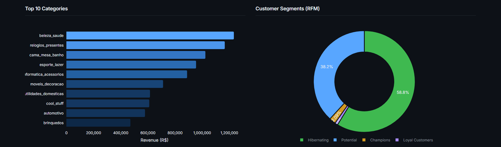
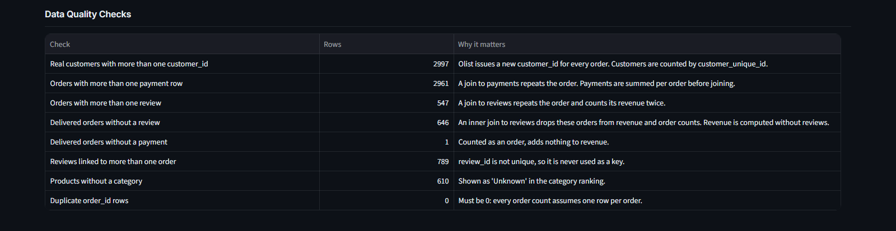

# E-Commerce Sales Intelligence

A data analytics platform built on the **Olist Brazilian E-Commerce** public dataset (2016–2018).  
Covers the full pipeline from raw CSV ingestion through SQL analysis, RFM customer segmentation, data quality checks, and an interactive Streamlit dashboard.

---

## Dashboard Preview

**KPIs & Revenue Trend**

<p align="center">
  
</p>

**Category Performance & Customer Segmentation**

<p align="center">
  
</p>

**Order Volume & Segment Breakdown**

<p align="center">
  
</p>

**Data Quality Checks**

<p align="center">
  
</p>

---

## Features

| Capability | Details |
|---|---|
| **Data Ingestion** | Loads 6 CSV datasets into a local SQLite database |
| **Revenue Analytics** | Monthly revenue trend with interactive Plotly charts |
| **Category Ranking** | Top 10 product categories by total revenue |
| **RFM Segmentation** | Classifies real customers (`customer_unique_id`) into Champions, Loyal, Potential, and Hibernating segments |
| **Data Quality Checks** | 8 checks for repeated keys, fan-out joins and missing links, shown on the dashboard |
| **Interactive Dashboard** | Streamlit-based web app with dark theme, metric cards, and responsive charts |
| **Modular SQL** | Standalone `.sql` files for each analytical query |
| **Tested** | 27 unit tests, including one for every data quality problem listed below |

---

## Data Quality

The first version of the dashboard reported several wrong KPIs. No query failed: each one
returned a plausible number built on a wrong assumption about the data. An audit of the
tables found the causes, the queries were rewritten, and every problem now has a test that
fails on the old code.

| Problem | Cause | Effect in the first version | Fix |
|---|---|---|---|
| Customers counted per order | Olist issues a new `customer_id` for every order; the person is `customer_unique_id` | Total Customers 95,831 instead of 93,358; the 2,801 real repeat buyers were invisible | Count and segment by `customer_unique_id` |
| RFM frequency counted payment rows | `payments` has one row per payment part (2,961 orders are paid in parts) | 2,875 single orders looked like repeat purchases | Payments are summed per order before the join |
| Segments depended on row order | Frequency was scored with `rank(method="first")`; with ~97% one-time buyers, row position set the score | Shuffling the rows moved 47% of customers to another segment; 7,186 of the 7,782 "Champions" had a single order | Fixed frequency bands; repeat vs one-time buyers first, then recency + monetary |
| Summary KPIs joined payments and reviews in one query | The join repeats an order per payment and per review, and drops orders without a review | 647 delivered orders were dropped (646 without a review, 1 without a payment): Total Orders 95,831 instead of 96,478, revenue R$ 58,539 too low | Each KPI is computed on its own table |
| Recency measured from today | `julianday('now')` | Average recency of 2,900–3,200 days in every segment | Measured from the last purchase in the data (2018-08-29) |
| Category ranking included undelivered orders | No status filter, unlike the other KPIs | Items of canceled and undelivered orders were counted | Delivered orders only |

Run the checks from the project root:

```bash
python -m src.data_quality
```

### Metric definitions

| Metric | Definition |
|---|---|
| Orders | Orders with status `delivered` |
| Revenue | Sum of `payment_value` for delivered orders (product price + freight) |
| Category revenue | Sum of item `price` for delivered orders (no freight), so categories do not add up to Revenue |
| Customers | Distinct `customer_unique_id` with at least one delivered order |
| Avg rating | Mean `review_score` over the reviews of delivered orders, each review once |
| RFM | Per `customer_unique_id`. Recency: days from the last delivered purchase to 2018-08-29. Frequency: delivered orders. Monetary: total payments. R and M are scored 1–5 by percentile (ties share a score); F is 1 for one order, 3 for two, 5 for three or more |
| Segments | Repeat buyers with R + M ≥ 7 are Champions, other repeat buyers Loyal Customers; one-time buyers with R + M ≥ 7 are Potential, the rest Hibernating |

---

## Project Structure

```
ecommerce-analytics/
├── .streamlit/
│   └── config.toml             # Dark theme configuration
├── dashboard/
│   └── app.py                  # Streamlit dashboard (entry point)
├── data/
│   ├── raw/                    # Original Olist CSV files
│   ├── processed/              # Transformed data (future use)
│   └── ecommerce.db            # SQLite database
├── docs/
│   └── images/                 # Dashboard screenshots
├── notebooks/
│   └── exploratory_analysis.ipynb
├── sql/
│   ├── monthly_revenue.sql
│   ├── top_categories.sql
│   ├── rfm_analysis.sql
│   └── summary_metrics.sql
├── src/
│   ├── __init__.py
│   ├── data_loader.py          # CSV → SQLite loader
│   ├── analyzer.py             # SQL-powered analytics engine and RFM scoring
│   └── data_quality.py         # Data quality checks
├── tests/
│   ├── conftest.py             # Sample database with the same traps as Olist
│   ├── test_data_loader.py
│   ├── test_analyzer.py
│   └── test_data_quality.py
├── requirements.txt
├── setup.py                    # One-time data ingestion script
└── README.md
```

---

## Getting Started

### Prerequisites

- Python 3.10 or higher
- The [Olist Brazilian E-Commerce dataset](https://www.kaggle.com/datasets/olistbr/brazilian-ecommerce) from Kaggle

### Installation

```bash
git clone <repo-url>
cd ecommerce-analytics

python -m venv venv
venv\Scripts\activate          # Windows
# source venv/bin/activate     # macOS / Linux

pip install -r requirements.txt
```

### Data Setup

Place the Olist CSV files into `data/raw/`, then run:

```bash
python setup.py
```

This reads each CSV and loads it into `data/ecommerce.db`.

### Launch the Dashboard

```bash
streamlit run dashboard/app.py
```

Open [http://localhost:8501](http://localhost:8501) in your browser.

---

## Running Tests

```bash
python -m pytest tests/ -v
```

Expected output: 27 tests passing across `test_data_loader.py`, `test_analyzer.py` and `test_data_quality.py`.

---

## Dataset

The project uses the **Brazilian E-Commerce Public Dataset by Olist**, containing approximately 100,000 orders placed between 2016 and 2018.

| Table | Description |
|---|---|
| `orders` | Order timestamps, status, and customer reference |
| `items` | Line items within each order |
| `products` | Product catalog with category names |
| `customers` | Customer geographic data |
| `payments` | Payment method and transaction value |
| `reviews` | Customer review scores (1–5) |

Source: [Kaggle — Olist Brazilian E-Commerce](https://www.kaggle.com/datasets/olistbr/brazilian-ecommerce)

---

## Tech Stack

| Layer | Technology |
|---|---|
| Language | Python 3.10+ |
| Data | pandas, NumPy |
| Database | SQLite |
| Visualization | Plotly |
| Dashboard | Streamlit |
| Testing | pytest |
| Notebooks | Jupyter |

---

## License

This project is intended for educational and portfolio purposes.
