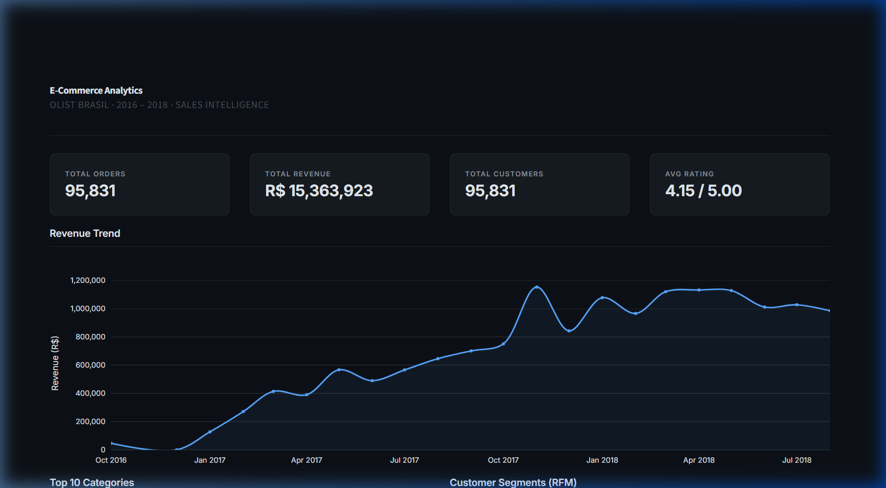
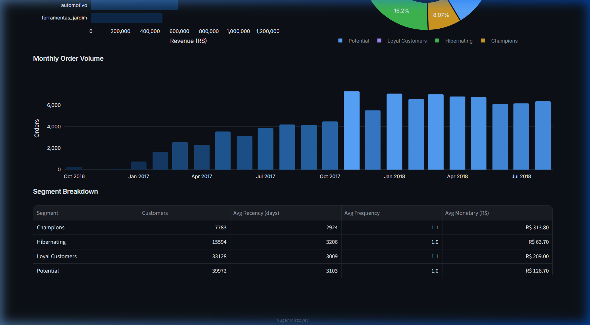

# E-Commerce Sales Intelligence

A data analytics platform built on the **Olist Brazilian E-Commerce** public dataset (2016–2018).  
Covers the full pipeline from raw CSV ingestion through SQL analysis, RFM customer segmentation, and an interactive Streamlit dashboard.

---

## Dashboard Preview

**KPIs & Revenue Trend**

<p align="center">
  
</p>

**Category Performance & Customer Segmentation**

<p align="center">
  
</p>

**Order Volume & Segment Breakdown**

<p align="center">
  
</p>

---

## Features

| Capability | Details |
|---|---|
| **Data Ingestion** | Loads 6 CSV datasets into a local SQLite database |
| **Revenue Analytics** | Monthly revenue trend with interactive Plotly charts |
| **Category Ranking** | Top 10 product categories by total revenue |
| **RFM Segmentation** | Classifies customers into Champions, Loyal, Potential, and Hibernating segments |
| **Interactive Dashboard** | Streamlit-based web app with dark theme, metric cards, and responsive charts |
| **Modular SQL** | Standalone `.sql` files for each analytical query |
| **Tested** | 13 unit tests covering the data loader and analysis engine |

---

## Project Structure

```
ecommerce-analytics/
├── .streamlit/
│   └── config.toml             # Dark theme configuration
├── dashboard/
│   └── app.py                  # Streamlit dashboard (entry point)
├── data/
│   ├── raw/                    # Original Olist CSV files
│   ├── processed/              # Transformed data (future use)
│   └── ecommerce.db            # SQLite database
├── docs/
│   └── images/                 # Dashboard screenshots
├── notebooks/
│   └── exploratory_analysis.ipynb
├── sql/
│   ├── monthly_revenue.sql
│   ├── top_categories.sql
│   ├── rfm_analysis.sql
│   └── summary_metrics.sql
├── src/
│   ├── __init__.py
│   ├── data_loader.py          # CSV → SQLite loader
│   └── analyzer.py             # SQL-powered analytics engine
├── tests/
│   ├── test_data_loader.py
│   └── test_analyzer.py
├── requirements.txt
├── setup.py                    # One-time data ingestion script
└── README.md
```

---

## Getting Started

### Prerequisites

- Python 3.10 or higher
- The [Olist Brazilian E-Commerce dataset](https://www.kaggle.com/datasets/olistbr/brazilian-ecommerce) from Kaggle

### Installation

```bash
git clone <repo-url>
cd ecommerce-analytics

python -m venv venv
venv\Scripts\activate          # Windows
# source venv/bin/activate     # macOS / Linux

pip install -r requirements.txt
```

### Data Setup

Place the Olist CSV files into `data/raw/`, then run:

```bash
python setup.py
```

This reads each CSV and loads it into `data/ecommerce.db`.

### Launch the Dashboard

```bash
streamlit run dashboard/app.py
```

Open [http://localhost:8501](http://localhost:8501) in your browser.

---

## Running Tests

```bash
python -m pytest tests/ -v
```

Expected output: 13 tests passing across `test_data_loader.py` and `test_analyzer.py`.

---

## Dataset

The project uses the **Brazilian E-Commerce Public Dataset by Olist**, containing approximately 100,000 orders placed between 2016 and 2018.

| Table | Description |
|---|---|
| `orders` | Order timestamps, status, and customer reference |
| `items` | Line items within each order |
| `products` | Product catalog with category names |
| `customers` | Customer geographic data |
| `payments` | Payment method and transaction value |
| `reviews` | Customer review scores (1–5) |

Source: [Kaggle — Olist Brazilian E-Commerce](https://www.kaggle.com/datasets/olistbr/brazilian-ecommerce)

---

## Tech Stack

| Layer | Technology |
|---|---|
| Language | Python 3.10+ |
| Data | pandas, NumPy |
| Database | SQLite |
| Visualization | Plotly |
| Dashboard | Streamlit |
| Testing | pytest |
| Notebooks | Jupyter |

---

## License

This project is intended for educational and portfolio purposes.
